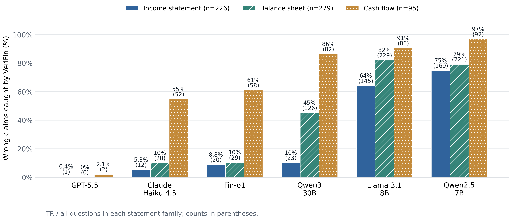
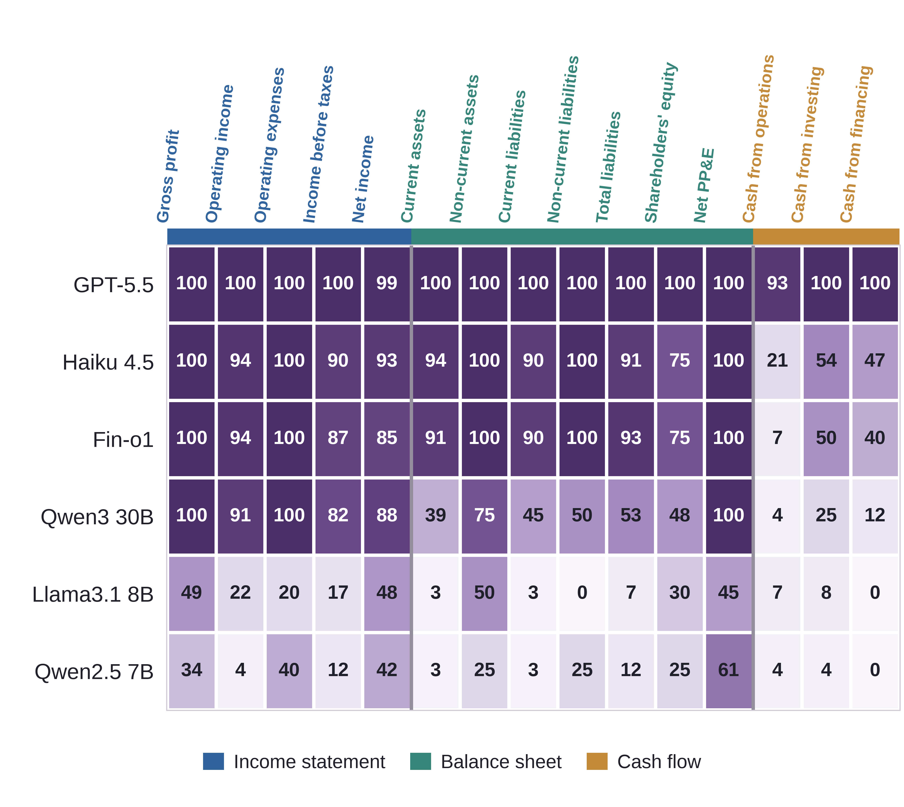
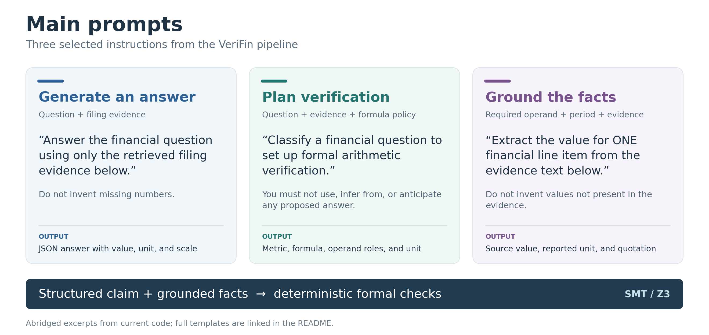

# VeriFin — anonymous review artifact

Verifying numerical financial answers against source evidence using formal
verification. This repository includes the code, saved results, notebooks,
and figures for the six-model evaluation.

This copy is prepared for anonymous peer review. Start with the saved notebooks
and figures below; all reported tables can be rebuilt offline. See the
[review artifact notes](docs/ANONYMOUS_REVIEW.md) for scope and provenance.

**6 models · 3 datasets · 18 runs · 6,420 answers**

- **Models:** Qwen2.5-7B, Llama-3.1-8B, Qwen3-30B, Fin-o1, Claude Haiku 4.5, GPT-5.5.
- **Datasets:** XBRLFiling (600 questions), FinanceBench (67), TADQA (403).

[Results](#results) · [Main prompts](#main-prompts) · [Quick start](#quick-start) · [Code map](docs/CODE_MAP.md) · [Generate new answers](docs/GENERATION.md)

## Quick start

Rebuild the tables and figures from the included results. Run these commands
from the repository root using **Python 3.12**:

```bash
python3.12 -m venv .venv
.venv/bin/python -m pip install -r requirements-analysis.txt
.venv/bin/python scripts/reproduce_submission.py
```

After installation, reproduction runs offline on a CPU with no model or API
key required. It executes the three main-result notebooks, checks the rebuilt numbers
against the audited results, and preserves the original prediction files.
The baseline comparisons have a separate offline workflow described below.

## Results

| What to view | Notebook | Downloads |
| --- | --- | --- |
| Main table: six models, three datasets, 95% confidence intervals | [Main results](notebooks/tatdqa_results.ipynb) | [CSV](paper/tables/models_three_datasets.csv) · [Overleaf](paper/tables/models_three_datasets.tex) · [Preamble](paper/tables/models_three_datasets_preamble.tex) |
| XBRLFiling heatmap and statement-family bars | [Plots](results/new_submissions/six_model_accuracy_heatmap.ipynb) | [PDF, PNG, SVG and CSV](results/new_submissions/figures/) |
| TADQA scores and statistics | [Detailed analysis](notebooks/tatdqa_result_metrics.ipynb) | [Outcome figure](paper/figures/tatdqa.pdf) · [Counts](paper/tables/tatdqa.csv) |
| Four LLM judges versus VeriFin on FinanceBench and XBRLFiling | [Baseline comparisons](notebooks/baseline_results.ipynb) | [CSV](results/new_submissions/baselines/comparison.csv) · [PDF](results/new_submissions/baselines/figures/four_model_baseline_comparison.pdf) · [Output audit](results/new_submissions/baselines/protocol_audit.csv) |

<p align="center">
  
  
</p>

The heatmap shows **generated-answer accuracy**. The bars show **true rejects
as a share of all questions in each statement family**. Main-table accuracy
measures **correct verifier decisions among scored, non-abstained cases**.

## Main prompts

Three selected prompts show how the main pipeline generates an answer, plans
verification independently of the proposed answer, and grounds numerical facts
in source evidence.

[](docs/figures/prompt_overview.svg)

These are abridged current templates, not an exact prompt archive for every
historical run. Full templates:
[answer generation](src/verifiqa/generation/answer_generator.py#L10),
[verification planning](src/verifiqa/agent/claim_classifier.py#L20), and
[fact grounding](src/verifiqa/agent/fact_extractor.py#L17).
Deterministic planning and table lookup can bypass the corresponding prompts;
formal constraints and Z3 determine the verdict in deterministic-SMT mode.
The [figure script](scripts/render_prompt_overview.py) checks the excerpts
against their source templates before rendering the PNG and SVG.

## Baseline comparisons

The Qwen2.5-7B, Qwen3-30B, Llama-3.1-8B, and GPT-5.5 judges have completed
**eight runs: 2,668 records across FinanceBench and XBRLFiling**. Every judge
evaluates its own model's saved answers. The audit found **2,655 exact
`CORRECT` or `INCORRECT` replies** and **13 empty-candidate abstentions**,
with no malformed replies, retries, or provider errors.

To reproduce these comparisons offline, open
[baseline_results.ipynb](notebooks/baseline_results.ipynb) in the analysis
environment and choose **Run All**. Its **Four model judge comparisons**
section validates the saved runs and rebuilds the comparison CSVs, per-question
outcomes, audit, and provenance. No model or API key is required. Rebuild the
figure from the exported CSV with:

```bash
.venv/bin/python scripts/plot_model_baselines.py
```

View the [PNG](results/new_submissions/baselines/figures/four_model_baseline_comparison.png),
[PDF](results/new_submissions/baselines/figures/four_model_baseline_comparison.pdf),
or [SVG](results/new_submissions/baselines/figures/four_model_baseline_comparison.svg).
The [run guide](docs/BASELINE_MODEL_RUNS.md) includes inference commands and
describes every exported file.

**All 44 previously unscored candidates have been reviewed: 25 correct and 19
incorrect.** The [review document](notebooks/baseline_full_answer_reviews.json)
contains exact source bindings, evidence, and rationales. These are **post hoc,
AI-assisted reviews, not independent human annotations**. The notebook opts
into `full_answer_correctness_review_v1`, which supplements the original numeric
scorer for those candidates and applies the same correctness label to both
methods. Saved answers, decisions, and abstentions remain unchanged. Every
comparison now reports precision, accuracy, and coverage, with zero unscored
decisions.

Inspect the [completed reviews](results/new_submissions/baselines/completed_answer_reviews.csv),
[before-review comparison](results/new_submissions/baselines/comparison_before_full_answer_review.csv),
and [original grading queue](results/new_submissions/baselines/unscored_before_full_answer_review.csv).
The [current queue](results/new_submissions/baselines/unscored_review_queue.csv) is empty.
Canonical reference caveats are retained, including FinanceBench's
`financebench_id_01328` income-statement versus footnote scope conflict; no gold
answer is silently changed. These baseline scores remain separate from the
reviewed main metrics. The earlier Haiku comparison and its significance tests
are historical; no new significance claims are made for these four judges.

## Folder structure

```text
verifin-review/
├── README.md                  # Start here
├── src/verifiqa/               # Answer generation, verification, and scoring
├── scripts/                    # Model launchers and reproduction commands
├── configs/                    # Model settings and Ollama configurations
├── notebooks/                  # Main table, TADQA analysis, and baseline comparisons
├── results/
│   └── new_submissions/        # The 18 saved runs and plotting notebook
│       ├── figures/            # Heatmap and bars: PDF, PNG, SVG, CSV
│       └── baselines/          # Eight judge runs, comparison CSVs, audit, completed reviews
│           └── figures/        # Four-model comparison: PDF, PNG, SVG
├── data/                       # Questions, reference answers, review evidence
├── datasets/xbrlfiling/         # Anonymous-author Hugging Face dataset release
├── paper/
│   ├── tables/                 # Main table, confidence intervals, LaTeX
│   ├── figures/                # TADQA outcome figure
│   └── provenance/             # Sources used for each table and figure
├── docs/                       # Code map, generation guide, data notes, prompt figure
├── reproducibility/            # Expected outputs, file hashes, validation
├── tests/                      # Scoring and table regression tests
├── artifacts/                  # Source-review records and derived statistics
├── publication_assets_source/  # Scoring policies and dataset notices
├── pyproject.toml              # Package and generation dependencies
└── requirements-analysis.txt   # Dependencies for offline reproduction
```

These are the main paths; retained historical audit files are described in
the [provenance notes](docs/DATA_AND_PROVENANCE.md). New model runs create
`results/reruns/`, which is excluded from Git.

## Explore the code or run a model

- [Code map](docs/CODE_MAP.md) — where generation, verification, scoring, and plotting happen.
- [Generation guide](docs/GENERATION.md) — model setup and CLI commands for new experiments.
- [Baseline run guide](docs/BASELINE_MODEL_RUNS.md) — one-word judges, offline comparisons, and grading policy.
- [Data and provenance](docs/DATA_AND_PROVENANCE.md) — inputs, scoring rules, and experiment history.
- [XBRLFiling dataset](datasets/xbrlfiling/README.md) — 600 questions, Parquet/JSONL, and CC BY-NC 4.0 terms.
- [Hugging Face upload](docs/XBRLFILING_HUGGINGFACE.md) — validation and upload commands for the dataset.

The implementation is in [`src/verifiqa/`](src/verifiqa/), with launchers in
[`scripts/`](scripts/). Reported results are in
[`results/new_submissions/`](results/new_submissions/); new model runs default
to `results/reruns/`. Fresh generation requires model access and the full source
document bundles described in the generation guide.

## Validation

All four notebooks executed successfully in this anonymous copy, and **379
regression tests passed**. The main and baseline tables match the validated
source package. Five figures are embedded in the saved notebooks for preview.
[View the validation record](reproducibility/validation.json).
The additional baseline [output audit](results/new_submissions/baselines/protocol_audit.csv)
and [provenance](results/new_submissions/baselines/comparison_provenance.json)
record the eight completed judge runs separately.

<details>
<summary>Check the saved inputs or run the tests</summary>

```bash
# Check all 18 input files without executing notebooks.
.venv/bin/python scripts/reproduce_submission.py --check-only

# Run the bundled regression tests.
PYTHONPATH=src:. .venv/bin/python -m pytest -q
```

</details>

## Research notes

- **Code history:** this is the current source snapshot. Exact code versions
  and settings were not recorded for every historical run.
- **Fin-o1 identity:** TADQA uses `TheFinAI/Fin-o1-8B`; the historical
  XBRLFiling and FinanceBench checkpoints remain unconfirmed.
- **Scoring:** source reviews and targeted TADQA reruns are post hoc.
  The main-table GPT-5.5 FinanceBench scorer retains two ungraded decisions,
  separate from the completed baseline grading above. The table caption and
  [provenance notes](docs/DATA_AND_PROVENANCE.md) explain exclusions and
  confidence-interval limits. Use the main table for current reported metrics.

## License

XBRLFiling's dataset compilation and original contributions are licensed under
[CC BY-NC 4.0](datasets/xbrlfiling/LICENSE.md). Other dataset notices retain their
own terms. The software license still needs an author decision.
See [license status](LICENSE_STATUS.md).
